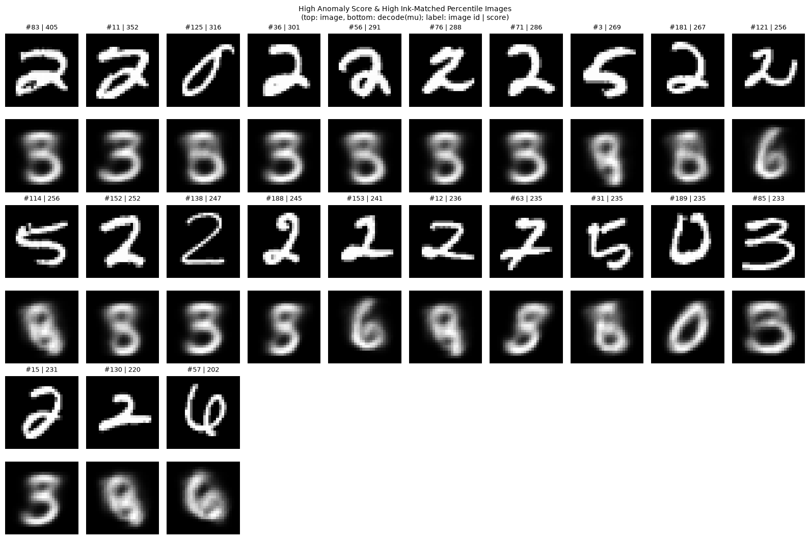

# VAE Batch Anomaly Audit Report

*Published by the VAE Auditor agent on 2026-11-25. Model: `gemini-3.5-flash-lite`. Batch: 200 images. Flagged: 23.*

## Summary

Out of 200 audited images, 23 images were flagged as anomalies based on both high overall reconstruction error (exceeding normal reference thresholds) and high ink-matched percentiles above 90 (ensuring the high scores are not simply artifacts of thick strokes). The flagged image IDs are 83, 11, 125, 36, 56, 76, 71, 3, 181, 121, 114, 152, 138, 188, 153, 12, 63, 31, 189, 85, 15, 130, and 57.

## Flagged images (23)

| Image id | Score | Ink-matched percentile | Agent's evidence |
|---:|---:|---:|---|
| 83 | 405.4 | 99.9 | Anomalous image with anomaly score 405.4 (overall percentile 100, ink-matched percentile 99.9). |
| 11 | 351.9 | 98.7 | Anomalous image with anomaly score 351.9 (overall percentile 99.9, ink-matched percentile 98.7). |
| 125 | 316.2 | 100.0 | Anomalous image with anomaly score 316.2 (overall percentile 99.7, ink-matched percentile 100). |
| 36 | 301.1 | 99.0 | Anomalous image with anomaly score 301.1 (overall percentile 99.6, ink-matched percentile 99). |
| 56 | 290.6 | 97.0 | Anomalous image with anomaly score 290.6 (overall percentile 99.4, ink-matched percentile 97). |
| 76 | 287.8 | 98.5 | Anomalous image with anomaly score 287.8 (overall percentile 99.4, ink-matched percentile 98.5). |
| 71 | 285.7 | 98.9 | Anomalous image with anomaly score 285.7 (overall percentile 99.3, ink-matched percentile 98.9). |
| 3 | 268.9 | 96.5 | Anomalous image with anomaly score 268.9 (overall percentile 98.9, ink-matched percentile 96.5). |
| 181 | 267.2 | 99.1 | Anomalous image with anomaly score 267.2 (overall percentile 98.9, ink-matched percentile 99.1). |
| 121 | 255.7 | 99.6 | Anomalous image with anomaly score 255.7 (overall percentile 98.3, ink-matched percentile 99.6). |
| 114 | 255.5 | 98.3 | Anomalous image with anomaly score 255.5 (overall percentile 98.3, ink-matched percentile 98.3). |
| 152 | 252.0 | 97.2 | Anomalous image with anomaly score 252 (overall percentile 98.1, ink-matched percentile 97.2). |
| 138 | 246.7 | 100.0 | Anomalous image with anomaly score 246.7 (overall percentile 97.8, ink-matched percentile 100). |
| 188 | 244.9 | 98.2 | Anomalous image with anomaly score 244.9 (overall percentile 97.7, ink-matched percentile 98.2). |
| 153 | 241.3 | 98.0 | Anomalous image with anomaly score 241.3 (overall percentile 97.4, ink-matched percentile 98). |
| 12 | 235.8 | 98.4 | Anomalous image with anomaly score 235.8 (overall percentile 97, ink-matched percentile 98.4). |
| 63 | 235.5 | 94.8 | Anomalous image with anomaly score 235.5 (overall percentile 96.9, ink-matched percentile 94.8). |
| 31 | 235.3 | 97.8 | Anomalous image with anomaly score 235.3 (overall percentile 96.9, ink-matched percentile 97.8). |
| 189 | 235.0 | 96.1 | Anomalous image with anomaly score 235 (overall percentile 96.9, ink-matched percentile 96.1). |
| 85 | 233.1 | 94.3 | Anomalous image with anomaly score 233.1 (overall percentile 96.7, ink-matched percentile 94.3). |
| 15 | 231.3 | 96.7 | Anomalous image with anomaly score 231.3 (overall percentile 96.5, ink-matched percentile 96.7). |
| 130 | 220.1 | 97.3 | Anomalous image with anomaly score 220.1 (overall percentile 95, ink-matched percentile 97.3). |
| 57 | 201.8 | 93.5 | Anomalous image with anomaly score 201.8 (overall percentile 91.3, ink-matched percentile 93.5). |

## Figures

## Reference thresholds (seen-digit training scores)

- p90_of_seen_training_scores: 197.3
- p95_of_seen_training_scores: 219.9
- p99_of_seen_training_scores: 271.0

---
*Scores and percentiles in the table were filled in by code from tool results. The summary and the evidence column were written by the model.*
